<p align="center">
  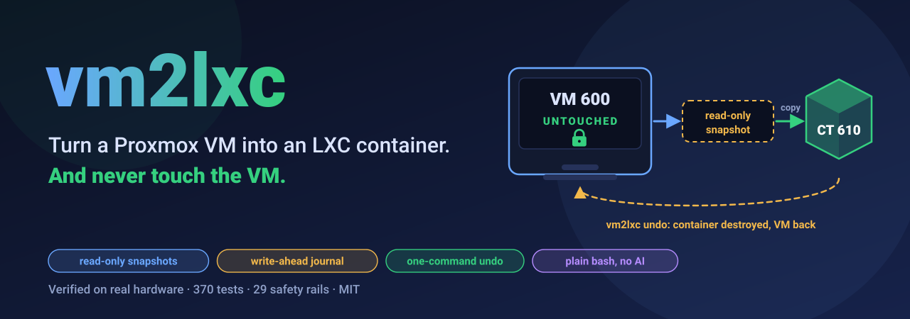
</p>

<p align="center">
  <b>Snapshot it. Mount it read-only. Look inside. Build a container from the copy. Undo it with one command.</b><br>
  Plain bash and <code>jq</code>. No AI in the tool. No network access. MIT licensed.
</p>

<table align="center">
  <tr>
    <td align="center"><b>Source disks written</b><br><code>0</code><br><sub>sha256-checked</sub></td>
    <td align="center"><b>Real-host round trips</b><br><code>4</code> guest types<br><sub>PVE 9.2 · LVM-thin</sub></td>
    <td align="center"><b>Tests</b><br><code>370</code><br><sub>0 skipped</sub></td>
    <td align="center"><b>Safety rails</b><br><code>29</code><br><sub>each mutation-tested</sub></td>
    <td align="center"><b>Status</b><br><code>alpha</code><br><sub>read the limits</sub></td>
  </tr>
</table>

<p align="center"><sub>
<a href="#the-30-second-version">30 seconds</a> ·
<a href="#why-this-exists">Why</a> ·
<a href="#the-six-commands">Commands</a> ·
<a href="#quick-start">Quick start</a> ·
<a href="#the-whole-process-step-by-step">The process</a> ·
<a href="#what-it-looks-at-the-12-guest-checks">Guest checks</a> ·
<a href="#what-changes-in-the-copy">Fix-ups</a> ·
<a href="#when-things-go-wrong">Failure &amp; undo</a> ·
<a href="#the-safety-model">Safety</a> ·
<a href="#what-it-can-do">Abilities</a> ·
<a href="#proven-on-real-hardware">Proof</a> ·
<a href="#limitations">Limits</a> ·
<a href="#development">Develop</a>
</sub></p>

---

> **Alpha, and honest about it.** vm2lxc has been run for real on **one** Proxmox VE 9.2 host with LVM-thin storage,
> against four disposable test VMs (a Debian 12 cloud image, a two-disk Debian, Alpine, and Ubuntu 24.04 with
> Tailscale). ZFS is implemented and tested against a fake only. [What is and is not proven](#proven-on-real-hardware)
> is spelled out below, and so are the [limitations](#limitations). Read them before pointing it at a VM you care about.

## The 30-second version

```console
$ vm2lxc scan 600 601 602 603
  #   VMID   NAME                      STATE    VERDICT  RAM now -> rec     SAVED    DISK
  1   601    vm2lxc-test-ubu24-ts      running  GREEN    2048M -> 1216M     832M     12G
  2   600    vm2lxc-test-deb12-svc     running  GREEN    1024M (keep)       -        10G
  ...

$ vm2lxc convert 600 --ctid 610 --yes --start
Mounted read-only:
  scsi0    rootfs  ext4   /dev/loop0p1
Guest checks: 12 ran, 0 pending.
  [INFO]   guest OS: Debian GNU/Linux 12 (bookworm) (detected ostype: debian)
  [YELLOW] cloud-init is installed: it is disabled in the copy so it cannot rewrite the network
  note: net0: interface 'eth0', MAC BC:24:11:CE:87:A6, bridge vmbr0
  note: the guest's netplan matches the NIC by MAC address (cloud-init does this); a container's veth has
        no permanent MAC, so the copy's netplan is changed to match by interface name
Building the container 610 ...
Done. Container 610 ("vm2lxc-test-deb12-svc") was created from VM 600.
  The container is RUNNING; VM 600 is stopped and set not to start at boot.
  To go back:  vm2lxc undo 610 --yes   (destroys the container, starts the VM again)
  NEVER start VM 600 while container 610 runs: they share one MAC address.

$ pct exec 610 -- ip -br -4 addr show eth0
eth0@if105       UP             10.0.0.228/24

$ vm2lxc undo 610 --yes
Undone. Container 610 is gone and VM 600 is running again.
```

<sub>Real output from a Proxmox VE 9.2.28 host (trimmed). About 20 seconds, including the graceful VM shutdown.</sub>

## Why this exists

Proxmox has no one-button VM-to-LXC path. The community tools that exist do the mechanical copy well, but the ones
we studied each make some of these trade-offs: they stop the VM and mount its disk **read-write**, tar a **running**
system, silently drop data with glob excludes (`*.gz`, `*.sql`, `/var/lib/docker`), give the container a new MAC, or
offer no real rollback. vm2lxc is built around the opposite defaults:

| Principle | What it means here |
|---|---|
| **The source is never modified** | Work happens on a storage-level snapshot, mounted read-only (`ro,noload`). The VM is only ever shut down, set to not autostart, and (by `undo`) started again. |
| **Know before you convert** | A red / yellow / green verdict with plain-words reasons, from the VM's config *and* from inside its disk (12 guest checks), before anything is created. |
| **Everything it creates, it can remove** | A write-ahead journal, a signal trap, `cleanup` for a crash, and `undo` for a finished conversion. |
| **Nothing silently lost** | No glob excludes on data. A second data filesystem that would not be copied refuses the conversion instead of dropping it. |
| **Fail safe, not clever** | One door for every host command: an allowlist of exact argument shapes. Identity is re-checked before anything is destroyed. |
| **Deterministic** | No AI, no heuristics you cannot read. A few thousand lines of plain bash you can audit in an afternoon. |

## The six commands

<p align="center">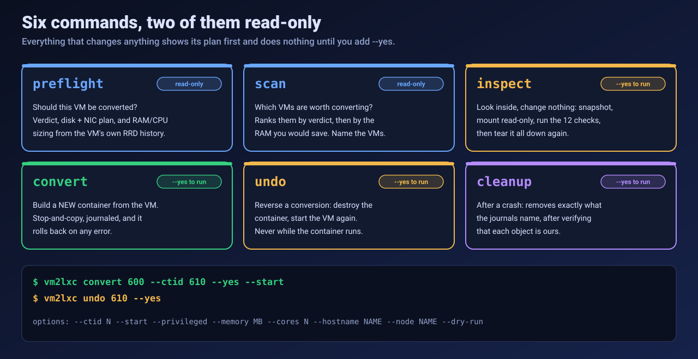</p>

| Command | What it does | Changes the host? |
|---|---|---|
| `preflight <vmid>` | verdict (exit 0/10/20), disk and NIC plan, RAM/CPU sizing from the VM's RRD history | no |
| `scan [vmid...]` | ranks VMs by verdict and RAM you would save | no |
| `inspect <vmid>` | plan; with `--yes` snapshots, mounts read-only, runs the 12 guest checks, tears down | only with `--yes` |
| `convert <vmid>` | plan; with `--yes` builds a **new** container from the VM | only with `--yes` |
| `undo <ct>` | shows what it will do; with `--yes` destroys the container and starts the VM again | only with `--yes` |
| `cleanup` | lists, and with `--yes` removes, what a crashed run left behind | only with `--yes` |

## Quick start

**Requirements:** a Proxmox VE 8.x or 9.x node, run as root. `bash` 4.4+, `jq`, `tar`, util-linux, and the PVE
tools already on the node (`qm`, `pct`, `pvesm`, `lxc-usernsexec`). `lvm2` for LVM-thin, `zfsutils` for ZFS.
No installer: it runs from a checkout.

```bash
git clone https://github.com/nixfred/vm2lxc.git && cd vm2lxc
./vm2lxc --help
```

**Try it with no Proxmox at all.** The repository ships canned data, including real output captured from a PVE 9.2
host. Fixture mode is loudly labelled and can never execute anything:

```bash
VM2LXC_FIXTURE_DIR=$PWD/tests/fixtures/pve9-real ./vm2lxc scan 600 601 602 603
VM2LXC_FIXTURE_DIR=$PWD/tests/fixtures/pve9-real ./vm2lxc convert 603 --ctid 900
```

**On a real node.** Read-only first, always. Every command that changes anything shows its plan and does nothing
until you add `--yes`:

```bash
./vm2lxc scan 600 601            # name the VMs: scan never reads the others
./vm2lxc preflight 600           # verdict + reasons + sizing from the VM's own history
./vm2lxc convert 600 --ctid 610  # the plan: nothing is executed
./vm2lxc convert 600 --ctid 610 --yes            # build the container, leave it STOPPED
pct start 610                                    # cut over when you are ready
./vm2lxc undo 610 --yes                          # changed your mind: container gone, VM back
```

<details>
<summary><b>What <code>preflight</code> tells you</b> (real output, trimmed)</summary>

```console
$ vm2lxc preflight 603
vm2lxc preflight 603  "vm2lxc-test-deb12-2disk"
  node hex | PVE 9.2.28 | live host

VERDICT: GREEN (provisional)
  No blockers in the VM config. 12 guest-internal checks still need disk inspection, so this is not a go-ahead.

Findings
  [info]   2 disks map to scsi0 -> rootfs, scsi1 -> mp0 (extra disks become container mount points)

Disks
  scsi0     local-lvm (lvmthin)          10G     -> rootfs  (boot disk)
  scsi1     local-lvm (lvmthin)          8G      -> mp0
```

The verdict is **provisional** until the guest has been looked inside (`inspect` or `convert`). What turns a VM red or
yellow *from its config alone*: PCI passthrough, Windows or non-Linux `ostype`, appliance names (pfSense, TrueNAS, ...),
USB or virtiofs passthrough, custom QEMU `args`, a TPM, raw host disks, a template or locked VM, an unsupported PVE
version, and storage vm2lxc cannot snapshot yet (tagged `(v1 limit)` so it is not mistaken for a fault of the VM).
Sizing comes from the VM's own RRD history, and **under 24 hours of history it refuses to guess** and keeps the current size.
</details>

## The whole process, step by step

<p align="center">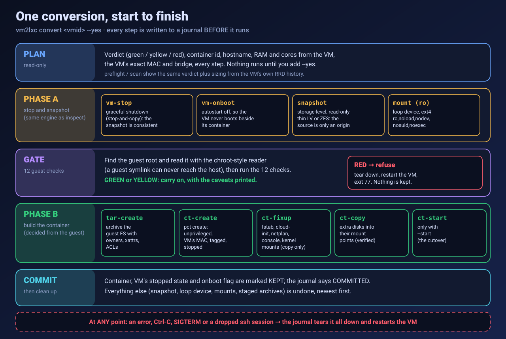</p>

`vm2lxc convert <vmid>` first prints the **plan** and stops. With `--yes` it runs the steps below. Every one is
written to a journal on disk *before* it executes, so a crash always leaves a trail that `cleanup` can follow.

| # | Step | What happens | Why |
|---|---|---|---|
| 0 | **plan** | reads the VM's config and volumes, runs the config checks, prints the verdict, the container's id, hostname, RAM, cores, the VM's exact MAC and bridge, and every step | nothing is a surprise; a RED verdict stops here |
| 1 | `vm-stop` | graceful shutdown (`qm shutdown`); if the VM will not stop, nothing is created | **stop-and-copy**: the snapshot is then consistent for every workload, databases included |
| 2 | `vm-onboot` | autostart is switched off (and restored by `undo`) | a VM that boots beside its container would be two copies of one machine |
| 3 | `snapshot` | storage-level snapshot of every source volume (thin LV, or ZFS), made read-only | the source is only ever the *origin*; it is never opened for writing |
| 4 | `mount` | loop device, partitions mounted `ro,noload,nodev,nosuid,noexec` | `noload` means even the filesystem journal is not replayed |
| 5 | **gate** | finds the guest root and runs the [12 guest checks](#what-it-looks-at-the-12-guest-checks) through the chroot-style reader | RED (Docker, NFS server, DKMS, ...) refuses: teardown, VM restarted, exit 77 |
| 6 | **decide** | hostname, RAM, cores; the NIC's interface *name* from the guest's own network config; each extra disk's mount path from the guest's fstab | the guest's network config then works unchanged |
| 7 | `tar-create` | the boot filesystem (and each extra disk) archived with `--numeric-owner --xattrs --acls` | permissions, capabilities and ACLs survive; no glob excludes, so nothing is silently dropped |
| 8 | `ct-create` | `pct create` from the archive: **unprivileged**, the VM's exact MAC, tagged `vm2lxc;vm2lxc-<run>`, created **stopped**, never starting at boot | the tag is how `undo` and `cleanup` later recognise *their own* container |
| 9 | `ct-fixup` | in the container's copy only: [fstab, cloud-init, netplan, console and kernel mounts](#what-changes-in-the-copy) | the disks and hardware the VM had are gone |
| 10 | `ct-copy` | each extra disk's data into its mount-point volume | written only into a *verified* mount point (see the safety model) |
| 11 | `ct-start` | only with `--start`: the cutover | otherwise the container waits stopped until you start it |
| 12 | **commit + teardown** | the container, the VM's stopped state and the autostart flag are marked `KEPT` and the journal says `COMMITTED`; everything else (snapshot, loop device, mounts, staged archives) is undone, newest first | what is left is exactly the result, and `undo` knows what to reverse |

### Where the data goes

<p align="center">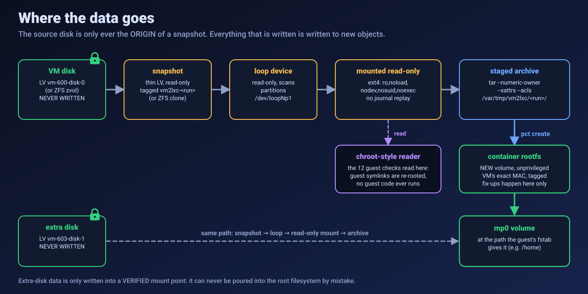</p>

The source disk is never written. Everything that *is* written goes into new objects: a snapshot, a staged archive, a
container volume. The 12 guest checks read the mounted guest through a **chroot-style reader**, so a hostile guest
cannot use a symlink to make the tool read or write a host file.

### The same thing as a conversation

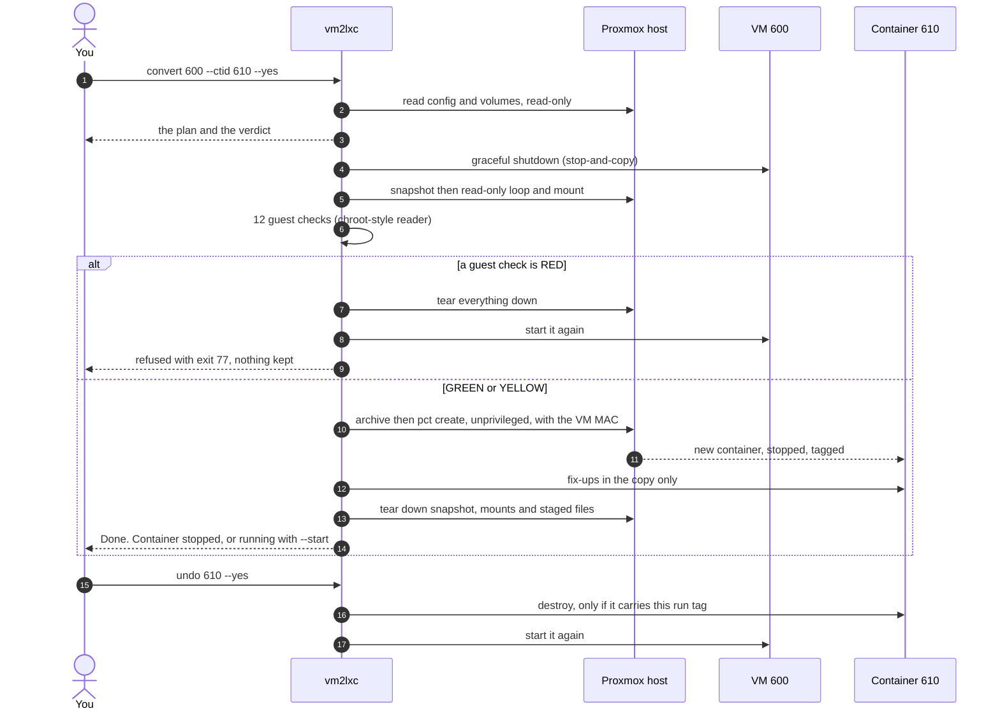

## What it looks at: the 12 guest checks

<p align="center">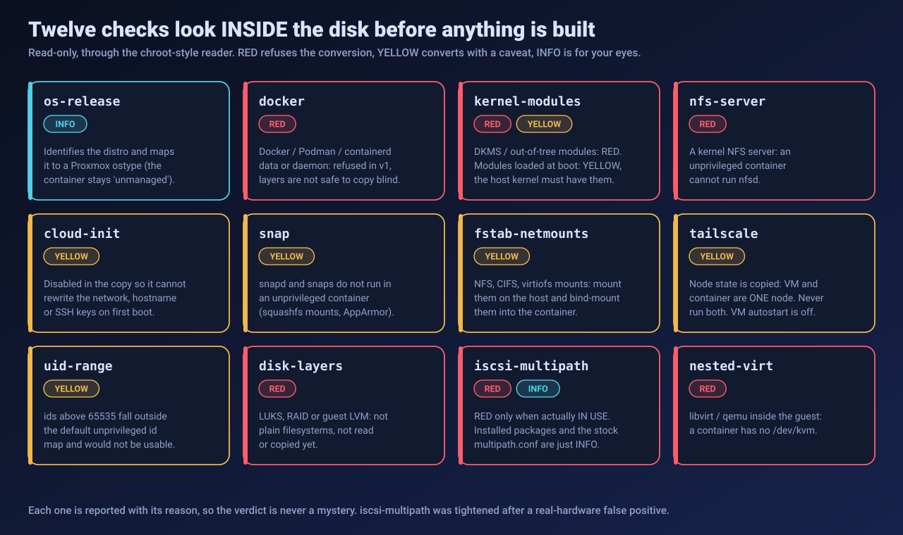</p>

Before anything is built, vm2lxc looks **inside the disk** (read-only) and reports what it finds, with the reason.
**RED** refuses the conversion, **YELLOW** converts with a caveat printed in the output, **INFO** is for your eyes.

| Check | Level | What it looks for | What happens |
|---|---|---|---|
| `os-release` | info | the distro and version | mapped to a Proxmox `ostype` (the container is still created `unmanaged`) |
| `docker` | RED | Docker, Podman or containerd data or daemon | refused in v1: layers are not safe to copy blindly |
| `kernel-modules` | RED / YELLOW | DKMS or out-of-tree modules (RED); modules loaded at boot (YELLOW) | the container has no kernel of its own |
| `nfs-server` | RED | a kernel NFS server (`nfs-kernel-server`, `/etc/exports`) | an unprivileged container cannot run `nfsd` |
| `cloud-init` | YELLOW | cloud-init installed | disabled in the copy |
| `snap` | YELLOW | snapd and snap files | snaps do not run in an unprivileged container |
| `fstab-netmounts` | YELLOW | NFS, CIFS, virtiofs mounts in fstab | mount them on the host and bind-mount them in |
| `tailscale` | YELLOW | Tailscale node state | the identity is copied: the VM and the container are **one node** |
| `uid-range` | YELLOW | uids or gids above 65535 | outside the default unprivileged id map |
| `disk-layers` | RED | LUKS, mdraid, guest LVM | not plain filesystems; not supported yet |
| `iscsi-multipath` | RED / INFO | iSCSI targets or multipath **in use** | RED only for real use; the installed packages and the stock config are INFO |
| `nested-virt` | RED | libvirt or qemu inside the guest | a container has no `/dev/kvm` |

## What changes in the copy

<p align="center">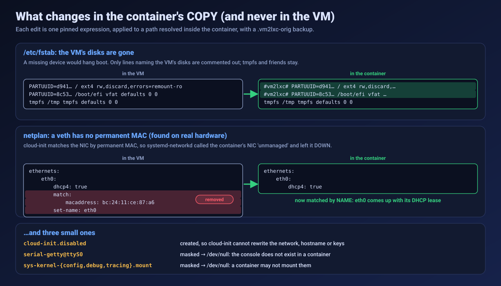</p>

Every edit is applied to the **container's copy** (never the VM) and is one pinned expression on a path that was
resolved *inside* the container. Fix-ups use host tools (`sed`, `cp`, `touch`, `ln`), never a binary from the guest.
The unprivileged ones run inside the container's user namespace, so file ownership comes out right and a mistake could not
touch a real-root file.

| Fix-up | Why |
|---|---|
| fstab lines naming the VM's disks (`UUID=`, `LABEL=`, `PARTUUID=`, `/dev/...`) commented out, `.vm2lxc-orig` backup kept | the disks are gone; a missing device would hang boot |
| `cloud-init` disabled (`/etc/cloud/cloud-init.disabled`) | it must not rewrite the network, hostname or SSH keys on first boot |
| netplan `match: macaddress:` + `set-name:` removed (cloud-init's exact shape only), backup kept | a container's veth has no permanent MAC, so `networkd` would leave the NIC unmanaged (**found on real hardware**) |
| `serial-getty@ttyS0` and `sys-kernel-{config,debug,tracing}.mount` masked | they can never work in an unprivileged container |
| `machine-id`, SSH host keys, hostname **kept** | it is the same machine, moved |

## When things go wrong

<p align="center">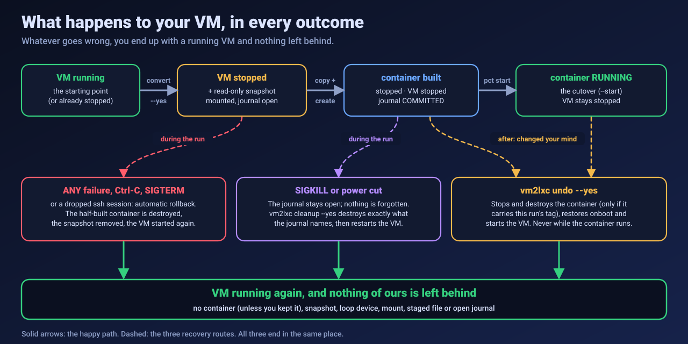</p>

There are three recovery routes and they all end in the same place: **a running VM, and nothing of ours left behind**.

- **Any failure, Ctrl-C, `SIGTERM`, `SIGHUP`, `SIGPIPE` or a dropped ssh session:** the trap tears everything down, in
  reverse order. The half-built container is destroyed (it carries the run's tag), the snapshot layer is removed, and the
  VM is started again if it was running. Signals that arrive *during* teardown are ignored so it cannot be cut short.
- **`SIGKILL`, a power cut, a kernel panic:** nothing can run, but the journal says exactly what may exist.
  `vm2lxc cleanup --yes` destroys exactly what the journal names, after verifying each object is ours.
- **You changed your mind after a successful conversion:** `vm2lxc undo <ct> --yes`.

### The journal

Every step is recorded as `PENDING` **before** it runs, so a crash always leaves a trail. A step that cannot be
recorded is not performed.

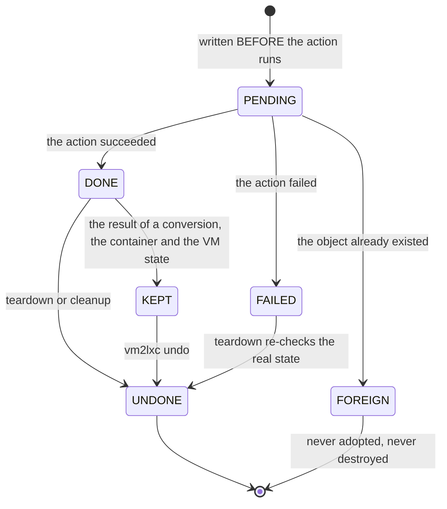

## The safety model

<p align="center">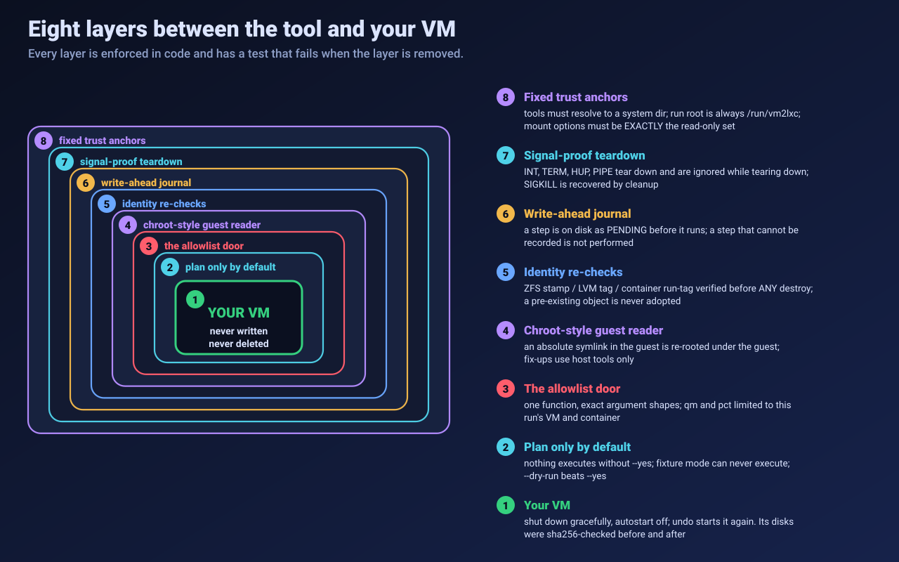</p>

A tool that runs as root on a hypervisor and destroys things has to be built as if every line will meet a bad day.
The full designs, with failure matrices, are in [`docs/snapshot-layer.html`](docs/snapshot-layer.html) (rails R1-R21) and
[`docs/convert.html`](docs/convert.html) (rails R22-R29). In short:

1. **The source is never written.** It is only the origin of a snapshot. A VM's only changes are a graceful shutdown,
   `onboot 0`, and (by `undo`) start and `onboot 1`. Its disk was sha256-checked before and after a real conversion.
2. **One door.** Every command that changes the host goes through `host_cmd` in `lib/hostexec.sh`, an allowlist of *exact
   argument shapes*. `qm` is limited to this run's VM, `pct` to this run's container, `pct create` to a fixed option set
   with every value pattern-checked, `tar` to two forms. Anything else is refused (exit `77`) before it runs.
3. **Only our objects, re-verified before every destroy.** ZFS stamp and clone origin, LVM tag and origin, and the
   container's per-run tag. A mismatch refuses and leaves the object alone. A pre-existing object with the wanted name is never adopted.
4. **The guest is hostile until proven otherwise.** It is read through a chroot-style resolver: an absolute symlink in
   the guest (`/etc -> /etc`) is re-rooted under the guest, never followed onto the host. A guest symlink to a host file is
   neither edited nor copied in (tested for fstab, netplan, cloud-init and the unit masks).
5. **A write-ahead journal that is honest.** A step that cannot be recorded is not performed; a journal that cannot be
   updated keeps the run open instead of pretending.
6. **"Could not tell" is never "gone".** A probe that times out or errors is an error; teardown stops there and `cleanup` retries.
7. **Never two live copies.** `undo` never starts the VM while the container runs; the VM is set not to autostart.
8. **Nothing silently lost.** No glob excludes. A data filesystem that would not be copied refuses the conversion.
9. **Signals cannot break the cleanup.** `SIGINT`, `SIGTERM`, `SIGHUP` and `SIGPIPE` tear down and are ignored while tearing down.
10. **Fixed trust anchors.** Tools must resolve to a system directory (a hostile `PATH` cannot substitute one), the run
    root is always `/run/vm2lxc`, mount options must be *exactly* the read-only set.

## What it can do

| Area | Ability |
|---|---|
| **Assess** | red / yellow / green verdict with reasons; sizing recommendation (p95 and max RAM, a confidence label, lean / recommended / keep) from the VM's own RRD history; ranks every VM on the node by verdict and RAM saved |
| **Inspect** | a read-only look inside any VM disk: snapshot, loop device, read-only mount, 12 guest checks, then everything removed again |
| **Convert** | a new **unprivileged** container with the VM's exact MAC, bridge and VLAN, hostname, RAM and cores; multi-disk VMs (boot disk to rootfs, each extra disk to a mount point at the path its fstab names); stop-and-copy for a consistent copy |
| **Cut over** | `--start` starts the container; otherwise it waits stopped until you `pct start` it |
| **Undo** | destroys the container (only if it carries this run's tag) and starts the VM again; says plainly if the VM was stopped before |
| **Recover** | `cleanup` finishes any run a crash left behind, from the journal |
| **Protect** | a journal, an allowlist, identity re-checks, a chroot-style guest reader, signal-proof teardown |

| Supported | Status |
|---|---|
| LVM-thin storage | verified on a real host |
| ZFS zvols | implemented, tested against a fake only; **never run on real hardware** |
| dir / qcow2, NFS, Ceph, thick LVM | not yet; reported with a plain reason |
| ext2 / ext3 / ext4 | verified (`ro,noload,nodev,nosuid,noexec`) |
| xfs, btrfs | implemented, not yet mounted for real |
| Debian, Ubuntu, Alpine guests | verified |
| other distros (Arch, Fedora/RHEL family, ...) | detected; expected to work, **not tested** |
| cloud-init / netplan, ifupdown, systemd-networkd, OpenRC | handled |

## Proven on real hardware

<p align="center">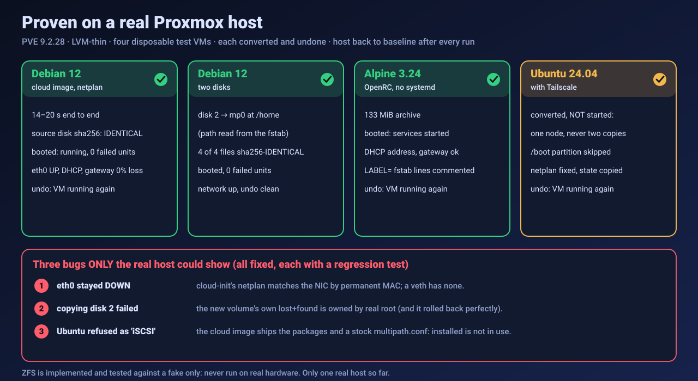</p>

Evidence matters more than claims. A Proxmox VE 9.2.28 host (LVM-thin), four disposable test VMs. Each was converted into
a container and undone again, and the host was compared with a baseline after every run: no snapshot, loop device, mount,
staging directory or open journal left.

| Guest | Result |
|---|---|
| **Debian 12** cloud image (netplan, cloud-init) | 14-20 s. Source disk sha256 **identical** before and after. Container fully booted (`running`, 0 failed units); `eth0` UP with a DHCP address under the VM's MAC; gateway and DNS reachable. `undo` restarted the VM. |
| **Debian 12, two disks** | the second disk became `mp0` at `/home` (read from the guest's fstab) as a separate volume; **every file sha256-identical** to the source disk. |
| **Alpine 3.24** (OpenRC, no systemd) | booted, OpenRC services started, DHCP address, gateway reachable. |
| **Ubuntu 24.04 + Tailscale** | converted but **deliberately not started** (a second copy of the node must not come online); config, copied Tailscale state, netplan change and fix-ups checked in the stopped container. |

**Three bugs only real hardware could show** (all fixed, each with a regression test): the container's NIC stayed down
because cloud-init's netplan matches the *permanent* MAC and a veth has none; copying the second disk failed on the new
volume's own root-owned `lost+found` (and rolled back perfectly); and Ubuntu was refused as "iSCSI configured" because
its cloud image ships the packages and a stock `multipath.conf`.

Also: the read-only engine underneath (`inspect`) was crash-tested with 61 injected `SIGKILL`/`SIGTERM`/`SIGHUP` runs on
the same host, and an independent fresh-context review found 12 issues, all fixed (rails R1-R21).

**370 tests, 0 skipped**, `shellcheck` clean. A stateful fake of `zfs`, LVM, `losetup`, `mount`, `qm` and `pct` drives
every row of the failure matrix. Every safety rail was **mutation-tested**: revert it, and a test goes red (more than 80
reversals; the few that first survived exposed real gaps in the tests, and were closed).

## Command reference

| Option | Meaning |
|---|---|
| `--yes` | really execute (`inspect`, `convert`, `undo`, `cleanup`). Without it they only print a plan. `--dry-run` beats `--yes`. |
| `--ctid N` | the container id to create (default: the next free id) |
| `--start` | start the container when done (the cutover); default is to leave it stopped |
| `--privileged` | create a privileged container (default: unprivileged) |
| `--memory MB`, `--cores N`, `--hostname NAME` | override what is taken from the VM |
| `--node NAME` | PVE node name (default: this host's short name) |

| Exit | Meaning |
|---|---|
| `0` / `10` / `20` | `preflight`: green / yellow / red |
| `64` | bad usage |
| `65` | the VM's disks cannot be planned (unsupported storage, unreadable path) |
| `66` | VM not found, or nothing to undo |
| `69` | environment problem (not root, not a PVE node, missing tool) |
| `70` | the plan cannot be executed (storage type not supported yet) |
| `77` | a safety rail refused an action, or a RED verdict stopped `convert` |

## Limitations

- **Alpha, one real host.** Only PVE 9.2.28 with LVM-thin has run for real. ZFS and PVE 8 are untested on hardware.
- **DHCP guests keep their MAC, not necessarily their IP.** In the test, the container got a different lease from the VM.
  The address is the DHCP server's decision; a reservation by MAC pins it. A guest with a static address keeps it.
- **Stop-and-copy only.** The VM is shut down for the copy; there is no `--live` two-pass mode yet.
- **Tailscale:** the node state is copied and the output warns loudly, but `undo` does not copy state back into the VM.
  The VM and the container are *one* node: never run both.
- **Privileged containers** (`--privileged`) are implemented but untested on hardware.
- The container keeps the guest's kernel and initramfs packages (unused). Staging needs free space in `/var/tmp`
  about the size of the guest. One filesystem per extra disk.
- **Everything written in the container after the conversion is lost by `undo`.** It does not copy data back.
- No interactive UI, vzdump safety backup, or soak-period reminder yet.

**Roadmap:** a real ZFS run, XFS/btrfs guests and other distros; `--live` two-pass copy (bulk from the snapshot, delta at
cutover); a verified `vzdump` backup before anything is offered for removal; a soak period; Tailscale hand-back on `undo`.

## Development

```bash
make lint      # shellcheck -x on everything
make test      # bats --recursive tests   (bats --jobs 4 --recursive tests is faster, needs GNU parallel)
```

Needs `bash` 4.4+, `jq`, `shellcheck`, `bats`, and optionally `strace`. No Proxmox host needed: the tests run the real code
against canned data and a fake storage host. See [CONTRIBUTING.md](CONTRIBUTING.md).

| Path | What it is |
|---|---|
| `vm2lxc` | entry script, flag parsing, command dispatch |
| `lib/pve.sh` | the **only** file that reads the host (`qm config`, `pvesh get`, `pvesm`), with a fixture mode |
| `lib/qmconf.sh`, `lib/storage.sh`, `lib/sizing.sh` | `qm config` and `pvesm status` parsing; RRD statistics |
| `lib/findings.sh`, `lib/checks_cfg.sh`, `lib/checks_guest.sh`, `lib/guestfs.sh` | the verdict engine, the config checks, the 12 guest checks, and the chroot-style guest reader |
| `lib/preflight.sh`, `lib/scan.sh` | the read-only commands |
| `lib/snapplan.sh` | the pure snapshot plan |
| `lib/hostexec.sh` | **the only file that may change the host**: allowlist, journal, lock, handlers, teardown |
| `lib/inspect.sh`, `lib/convert.sh` | `inspect`, `cleanup`, `convert`, `undo` |
| `docs/` | the two design pages with rails and failure matrices, and the diagrams in `docs/img/` |
| `tests/` | 15 bats files, a stateful fake host, stub PVE binaries, two fixture hosts |

## FAQ

**Will it delete my VM?** No. It never deletes a VM and never writes its disks. After `convert` the VM is stopped and set
not to autostart; `undo` starts it again. You decide if and when to remove it.

**What if it crashes halfway?** The journal records every step *before* it runs. `vm2lxc cleanup --yes` removes exactly
what the journal names, after verifying each object is ours.

**Can I convert a running VM?** It shuts the VM down gracefully first (stop-and-copy), so the copy is consistent. If the
VM will not stop, nothing is created.

**Why is the container created "unmanaged"?** So Proxmox does not rewrite the guest's own network configuration; the
container gets the VM's exact MAC and the interface name the guest's config already uses.

**Why does it refuse Docker?** A Docker host keeps its state in layers and volumes that are not safe to copy blindly, and
needs nesting the v1 container does not set up. It is reported RED with that reason rather than half-converted.

**Does it phone home or use AI?** No. No network access, no AI. The decisions are plain, readable bash.

## Security

Anything that lets the tool write to a source volume, destroy something it did not create, or follow a guest path onto the
host is a security issue: see [SECURITY.md](SECURITY.md).

## Credits

vm2lxc is a fresh implementation, but it stands on ideas first worked out in two MIT-licensed projects, and the author is
grateful to their authors: [ArMaTeC/lxc-to-vm](https://github.com/ArMaTeC/lxc-to-vm) (`vm-to-lxc.sh`: host-side offline
conversion, the exclude list, per-distro network fix-ups) and
[thushan/proxmox-vm-to-ct](https://github.com/thushan/proxmox-vm-to-ct) (the first-boot cleanup unit and the boot-package
cleanup list). No code has been copied from either; see [NOTICE](NOTICE).

## License

[MIT](LICENSE).
